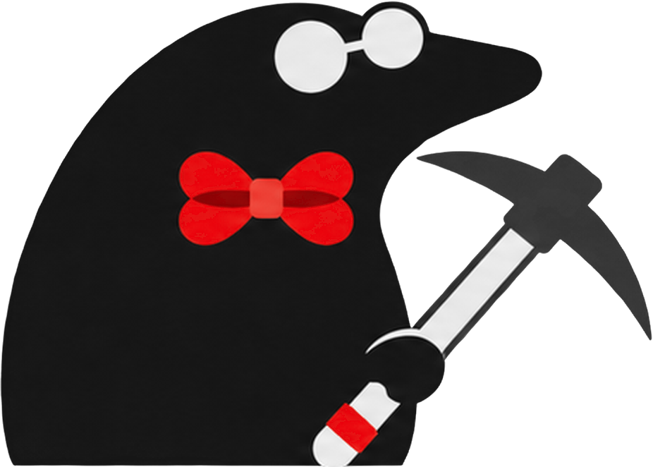
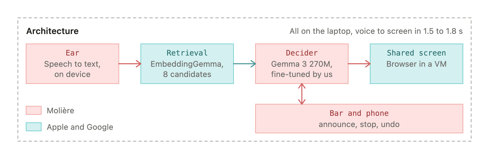
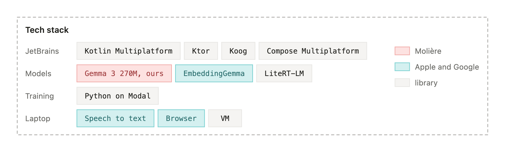
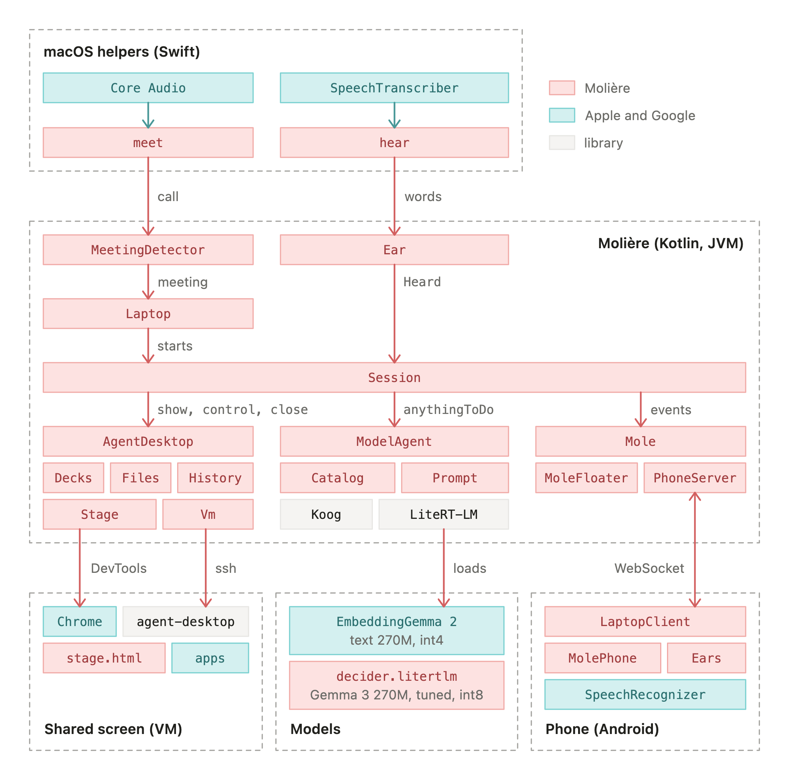
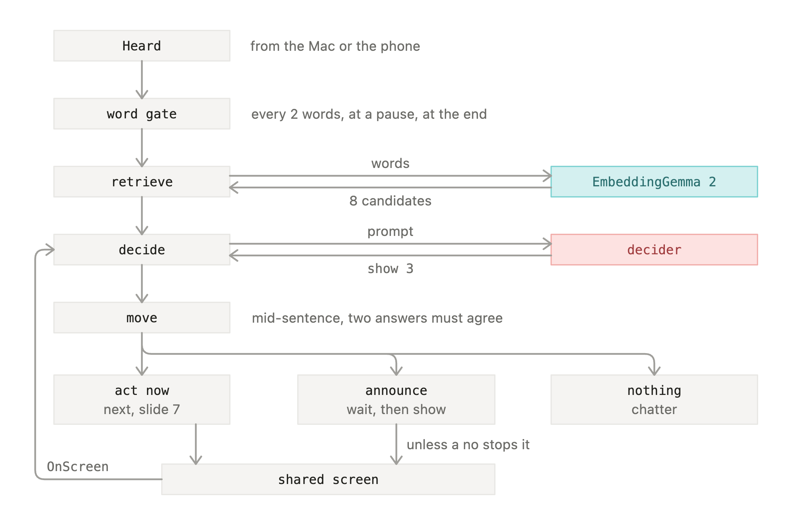
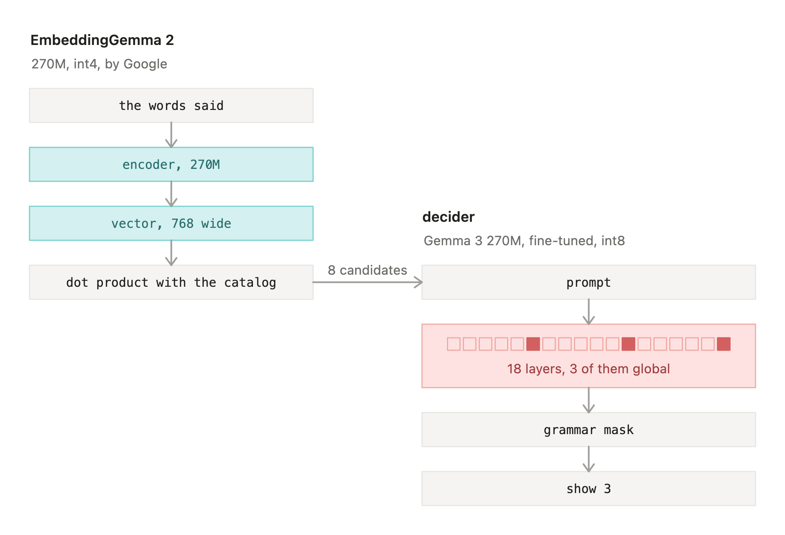
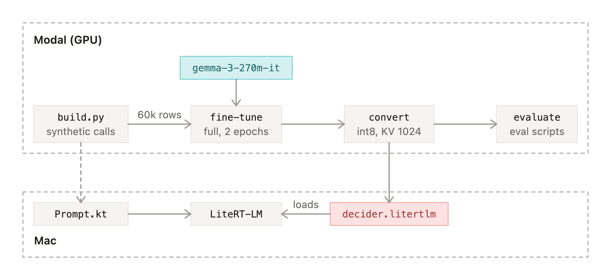
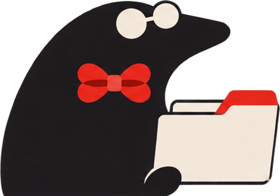

<p align="center">
  <picture>
    <source media="(prefers-color-scheme: dark)" srcset="docs/readme/microphone-dark.png">
    
  </picture>
</p>

<h1 align="center">Molière</h1>

<p align="center"><b>Automated co-presenter.</b><br>LauzHack 2026 · Alt+F4</p>

Molière listens to you during a call and puts the right slide, file, website or app on the screen you share. You talk to your audience as usual; Molière works out when you are asking for something and drives the shared screen for you.

It is one Kotlin Compose Multiplatform app: a desktop app on your Mac and an Android companion on the phone in your hand. Speech recognition and both models run on the Mac, inside the app. There is no model server. For the jury: [JetBrains challenge](#jetbrains-challenge).

## JetBrains challenge

| Requirement or extra point | How Molière meets it | Where to see it |
| --- | --- | --- |
| An app running on at least 2 platforms | Desktop (`jvm("desktop")` target in `:composeApp`, run with `./gradlew :composeApp:run`) and Android (`android` target in `:composeApp`, app module `:androidApp`, run with `./gradlew :androidApp:installDebug`). The phone is the companion: it shows the bar's state, sends Stop and picks, and can be the microphone. | [settings.gradle.kts](settings.gradle.kts), [composeApp/build.gradle.kts](composeApp/build.gradle.kts), [androidApp/build.gradle.kts](androidApp/build.gradle.kts) |
| Shared logic in commonMain | The session loop, the agent's prompt and policy, the catalog, the phone link client, the words and the UI are written once. | [composeApp/src/commonMain](composeApp/src/commonMain/kotlin/ch/lauzhack/app) |
| Jetpack Compose / Compose Multiplatform for UI | The bar, the mole and the phone screen are common Compose code. | [mole/MoleBar.kt](composeApp/src/commonMain/kotlin/ch/lauzhack/app/mole/MoleBar.kt), [mole/MolePhone.kt](composeApp/src/commonMain/kotlin/ch/lauzhack/app/mole/MolePhone.kt) |
| Dark/light mode | `MoleColors` has a light and a dark palette; `MoleTheme` follows the system or is forced from the tray menu. | [mole/Theme.kt](composeApp/src/commonMain/kotlin/ch/lauzhack/app/mole/Theme.kt) |
| Localization (multi-language support) | Every word a person reads is in English, Deutsch, Français, Italiano or Rumantsch, chosen from the system language or the settings. The app hears English only. | [Lang.kt](composeApp/src/commonMain/kotlin/ch/lauzhack/app/Lang.kt) |
| Kotlin backend integration | The laptop is the backend: a Ktor server on the desktop serves the phone over a WebSocket on the local network, and a common Ktor client on the phone talks to it. | [PhoneServer.kt](composeApp/src/desktopMain/kotlin/ch/lauzhack/app/link/PhoneServer.kt), [LaptopClient.kt](composeApp/src/commonMain/kotlin/ch/lauzhack/app/link/LaptopClient.kt) |
| Shared AI/agent logic with Koog | Koog is a commonMain dependency. The agent (`ModelAgent`, `Catalog`, `Prompt`) is in commonMain and finds candidates through Koog's `Embedder` interface. The model runs through Koog's `LLMClient` for LiteRT-LM, adapted from Koog's sources to the JVM; that part is desktop-only, as the phone loads no model. | [decider/ModelAgent.kt](composeApp/src/commonMain/kotlin/ch/lauzhack/app/decider/ModelAgent.kt), [engine/LiteRTLLMClient.kt](composeApp/src/litert/kotlin/ch/lauzhack/app/engine/LiteRTLLMClient.kt) |

### What is shared, what is platform-specific

Shared, in `composeApp/src/commonMain/kotlin/ch/lauzhack/app`:

- `Contract.kt`: what the ear, the agent and the screen exchange.
- `session`: the loop from words to moves, the mole line as a state machine, offers and undo.
- `decider`: the agent's prompt, grammar, catalog of candidates and decision policy.
- `engine`: where the models are stored.
- `link`: the phone's Ktor client and the messages between laptop and phone.
- `mole`: the Compose UI, the themes and the mole's rig.
- `Lang.kt`: the words in five languages.

Platform-specific, because it depends on one platform's system:

- `desktopMain`: the microphone and Apple's speech recognizer (`stage/Ear.kt`), the shared-screen VM and its browser (`stage`), meeting detection, the Ktor server, the tray and windows (`Main.kt`).
- `litert`: the LiteRT-LM model engine, added to the desktop source set only.
- `androidMain`: the phone's microphone (`link/Ears.kt`), its link and buzzes (`link/Phone.kt`), its system theme.
- `androidApp`: the Android activity that hosts the common UI.

### The measured share

| Source set | Lines of Kotlin |
| --- | --- |
| `commonMain` | 3456 |
| `desktopMain` | 3426 |
| `litert` (desktop only) | 974 |
| `androidMain` | 208 |
| `androidApp` | 55 |
| Tests: `commonTest` / `desktopTest` | 1485 / 3888 |

The phone app is 93% common code (3456 of 3719 lines). The desktop app is 44% common code (3456 of 7856); the rest drives the Mac's speech, the VM and the model. Recount:

```sh
for d in composeApp/src/*/ androidApp/src/*/; do echo "$d $(find $d -name '*.kt' | xargs cat | wc -l)"; done
```

### How it was built with agents

We built Molière with JetBrains Air. Coding agents worked side by side in parallel git worktrees (the `worktree-agent-*` branches), one task each. A person reviewed each result and merged it, sent it back, or left it out.

- One agent wrote the shared words table in five languages ([1e02295](../../commit/1e02295)) while another made the desktop-only VM host part of Molière ([3d4abf8](../../commit/3d4abf8)) and others trained the decider ([cd2fa08](../../commit/cd2fa08)).
- Model candidates were compared on the same 284 cases: an untrained Gemma 4 E2B decided 111 right, our trained 270M decided 230 ([e7cc578](../../commit/e7cc578), [583326c](../../commit/583326c)). The 270M stayed the model.
- The fine-tune went through rounds, each scored the same way, before one was kept ([56d6aa3](../../commit/56d6aa3) took round 4, [cd2fa08](../../commit/cd2fa08) round 6).
- Some results were refused. A decider trained from FunctionGemma got 231 of 340 heard lines right with 19 false switches, against 237 and 12 for plain Gemma, so it was dropped. A change that focuses the ear on one voice stays unmerged until it is checked on a real voice.

## What the presenter sees

<picture>
  <source media="(prefers-color-scheme: dark)" srcset="docs/readme/stopwatch-dark.png">
  
</picture>

A small bar at the bottom of your screen shows what Molière heard and what it is doing. Commands on what is already on screen act at once: "Next slide please.", "Go to slide 7.", "Scroll down a bit.", "Close that." A request by meaning, such as "So how big is this market really?", is announced first ("Showing slide 5") next to a Stop button that drains for up to 2.5 seconds. Say "no", or press Stop on the bar or the phone, and nothing reaches the shared screen. After something is shown, "no, go back" puts the previous screen back. Chatter does nothing: "I sent the PDF to Marc this morning." is not a request.

The phone shows the same mole and line as the bar, with the same buttons, and buzzes when something needs you.

Outside a call, Molière does not listen and has no phone link. It wakes when a call app takes the microphone, or when you choose **Start a meeting** from the mole in the menu bar.

## Mime mode

<picture>
  <source media="(prefers-color-scheme: dark)" srcset="docs/readme/mime-dark.png">
  
</picture>

Molière has two modes. Present is the one the rest of this README describes. Mime is for places where you cannot talk: you mouth sentences at the camera, the lip reader in `lipreading/` reads them, and each finished sentence is said aloud in your own cloned voice while the mole, drawn as a mime, shows the words.

The switch inside the app is being wired; today the lip reader runs on its own. Set it up once, then run it:

```sh
brew install git-lfs && git lfs pull    # the models, 5.4 GB
lipreading/setup.sh                     # its Python environment
cd lipreading && .venv/bin/python lipread.py
```

The models and the lip and voice profile in the repository are fitted to their author; to fit your own, see [lipreading/README.md](lipreading/README.md).

## How a sentence reaches the screen

<picture>
  <source media="(prefers-color-scheme: dark)" srcset="docs/readme/pickaxe-dark.png">
  
</picture>

1. **Hearing.** Apple's SpeechTranscriber (macOS 26) turns your voice into words on the Mac. `stage/Ear.kt` runs `hear.swift` and tells it which names to expect: your decks, slide titles, sites and apps.
2. **Session.** `session/Session.kt` passes each new version of the utterance to the agent with what the audience sees now. `Contract.kt` is the contract between ear, agent and screen: `Heard` and `OnScreen` in, a `Move` out.
3. **Retrieval.** EmbeddingGemma embeds the utterance and takes eight candidates from the catalog (`decider/Catalog.kt`): the meeting's slides and documents, bookmarks, apps, and what you saw lately (recent files, browser pages, decks elsewhere on the Mac).
4. **Decision.** `decider/Prompt.kt` writes the screen, the last utterances and the numbered candidates into a short prompt. A Gemma 3 270M fine tuned for this task (`decider.litertlm`) answers one line from a small grammar: `show 3`, `next`, `control scroll down`, `undo`, `nothing`.
5. **Action.** `decider/ModelAgent.kt` turns the answer into a move. Picks by meaning wait as long as the model's score leaves doubt; commands act at once. The session carries out one move at a time and tells the bar and the phone.
6. **Shared screen.** The audience sees Chrome in kiosk mode inside a macOS VM run by `agent-desktop`, driven over the DevTools protocol by `stage/Stage.kt`. You share the VM window, titled "Molière screen".

Only the models interpret speech: no word list or pattern reads what you say. `tune/CONTRACT.md` defines the prompt, the grammar and what each answer does; the training code and the app both follow it.

## Architecture

<picture>
  <source media="(prefers-color-scheme: dark)" srcset="docs/readme/architecture-dark.png">
  
</picture>

All of it runs on the laptop, and a request reaches the shared screen 1.5 to 1.8 seconds after you stop speaking. Apple's on-device speech recognizer hears you, EmbeddingGemma finds eight candidates, and our fine-tuned Gemma 3 270M decides what to show on the shared screen, Chrome in a macOS VM. The bar and the phone announce each pick and let you stop it or undo it.

<picture>
  <source media="(prefers-color-scheme: dark)" srcset="docs/readme/tech-stack-dark.png">
  
</picture>

Molière is one Kotlin Multiplatform app, with Compose Multiplatform for the bar and the phone, Ktor for the link between them, and Koog with LiteRT-LM for the models. We train the decider in Python on Modal.

<picture>
  <source media="(prefers-color-scheme: dark)" srcset="docs/readme/system-components-dark.png">
  
</picture>

The system components: Swift helpers on macOS (meet, hear) feed MeetingDetector and Ear, a Session in the Kotlin app drives AgentDesktop, ModelAgent and Mole, and these reach Chrome in the VM over DevTools and ssh, load the two models, and talk to the Android phone over a WebSocket.

<picture>
  <source media="(prefers-color-scheme: dark)" srcset="docs/readme/decision-loop-dark.png">
  
</picture>

The decision loop: every 2 words, at a pause and at the end, the words go to EmbeddingGemma 2 for 8 candidates, the decider gets the prompt and answers, and a move made mid-sentence needs two answers that agree before Molière acts now, announces and waits, or does nothing.

<picture>
  <source media="(prefers-color-scheme: dark)" srcset="docs/readme/models-dark.png">
  
</picture>

The models: EmbeddingGemma 2 (270M, int4, by Google) turns the words said into a vector 768 wide whose dot product with the catalog gives 8 candidates, and the decider (Gemma 3 270M, fine-tuned, int8, 18 layers of which 3 are global) reads the prompt under a grammar mask and answers, for example show 3.

<picture>
  <source media="(prefers-color-scheme: dark)" srcset="docs/readme/fine-tuning-dark.png">
  
</picture>

Fine-tuning: on a Modal GPU, build.py writes 60k rows of synthetic calls, gemma-3-270m-it is fully fine-tuned for 2 epochs, converted to int8 with a KV cache of 1024 and evaluated, and on the Mac LiteRT-LM loads the resulting decider.litertlm with the prompt from Prompt.kt.

## Run it

<picture>
  <source media="(prefers-color-scheme: dark)" srcset="docs/readme/folder-dark.png">
  
</picture>

You need macOS 26 with Xcode's command line tools (`xcode-select --install`), [mise](https://mise.jdx.dev/) and [uv](https://docs.astral.sh/uv/). For the shared screen you need `agent-desktop` (`npm install -g agent-desktop`) and its VM, set up once as described below. Without the VM, `--host` uses a Chrome window on your Mac.

```sh
mise trust && mise install          # JDK 21, Android SDK; accept the licenses when asked
mise exec -- ./gradlew :composeApp:createDistributable
uv run --no-project --with reportlab python fixtures/make_decks.py library
python3 -I fixtures/make_documents.py library
```

The app is `composeApp/build/compose/binaries/main/app/Moliere.app`. On first start it downloads EmbeddingGemma to `~/Library/Application Support/Moliere/models/`. Put `decider.litertlm` in the same folder; it comes from the fine tune in `tune/` (see `tune/README.md`). Without it, a meeting says "Couldn't load the models." and names the missing file.

```sh
APP=composeApp/build/compose/binaries/main/app/Moliere.app
$APP/Contents/MacOS/Moliere --demo                                          # the bar's scripted story, no models or VM
$APP/Contents/MacOS/Moliere --typed --library "$PWD/library" --no-history   # type lines instead of speaking; add --host without a VM
open $APP                                                                   # the real thing, from the menu bar mole
```

With `--typed`, wait for "Hi. I'm listening.", then type a line and press Return. The log is `~/Library/Logs/Moliere/moliere.log`, and what the audience saw after each change is in `~/Library/Logs/Moliere/screens/`. The flags are listed above `fun main` in `composeApp/src/desktopMain/kotlin/ch/lauzhack/app/Main.kt`.

For the phone, run `mise run android` with the phone connected (or `mise run android:emulator:setup` once, then `mise run android:emulator`). Put the phone and the Mac on the same network, ideally the phone's hotspot. The phone finds the laptop once a meeting runs. Allow microphone access and keep the companion open. Both microphones stay listening, so the phone can take over as you walk away. Molière compares signal levels and room noise, learns the microphones' relative gain during a second of speech near the Mac, and checks for a weak Mac signal even before that comparison is ready. It takes three consecutive 100 ms frames to choose the phone and a second of good Mac audio to return. If phone audio stops arriving for 700 ms, the Mac takes over. The phone's mic indicator shows the choice; handoffs do not change the computer floater. During a meeting the phone streams microphone audio to the Mac over the local, unencrypted WebSocket connection, and the Mac transcribes it locally. Leaving the Android app stops the stream.

`DEMO.txt` is the page the team reads before going on stage: the launch, the pitch script and what each line must show, what to do when something goes wrong, Mime mode and a second scenario.

## One-time VM setup

1. `agent-desktop sandbox install macos`.
2. Get a macOS 26.x restore image. Apple's catalog offers only 27.x, which a 26.4 host cannot run. The 26.4 image is `https://updates.cdn-apple.com/2026WinterFCS/fullrestores/122-00766/062A6121-2ABE-45D7-BCB1-72B666B6D2C2/UniversalMac_26.4_25E246_Restore.ipsw` (19.7 GB, `shasum` 177baf85518c6e9cebf83990e11e59259b5c97dd).
3. `agent-desktop sandbox create base --provider macos --set ipsw=<path>`, then repeat `agent-desktop sandbox status base` until it stops answering `working`. Delete the image afterwards.
4. Optional: lower `memorySize` in `~/.agent-desktop/sandboxes/base/vm/config.json` from 8589934592 to 4294967296.
5. `agent-desktop sandbox start base --window --set title="Molière screen"`.
6. In the guest, finish Setup Assistant with the same short name as your Mac account (`cat ~/.agent-desktop/sandboxes/base/guest_user`) and turn on automatic login.
7. In the guest Terminal, run `sh "/Volumes/My Shared Files/guest-setup.sh"`.
8. In the guest, turn on Remote Login (System Settings > General > Sharing) and allow Accessibility for `sshd-keygen-wrapper`.
9. On the host, `agent-desktop sandbox status base` answers `running`.

At each meeting start, `Vm.setup` in `stage/Vm.kt` finishes the job when needed: it makes the VM's host a part of Molière, with no Dock icon or menu bar of its own, shares Desktop, Documents and Downloads read only at the same paths, matches your screen size, wallpaper and appearance, installs Chrome and restarts the VM. It patches `agent-desktop`'s VM host to share the folders, so it runs again after an `agent-desktop` update. It also starts the VM when it is stopped. To rerun step 7 later, the script is at `/Volumes/My Shared Files/agent-desktop/guest-setup.sh`.

## Test

<picture>
  <source media="(prefers-color-scheme: dark)" srcset="docs/readme/magnifier-dark.png">
  
</picture>

```sh
mise exec -- ./gradlew :composeApp:desktopTest                   # session, catalog, prompt (byte for byte against tune/golden.jsonl), stage, link, UI
rehearsal/run.sh rehearsal/demo.txt .stage/rehearsal/demo 6       # a scenario typed into the packaged app, against the VM
python3 rehearsal/check.py .stage/rehearsal/demo                  # each line scored, with the cause of each miss
AVD=lauzhack-2026 mise exec -- androidApp/check.sh                # the phone app end to end on an emulator
```

Screenshot renders of the bar and the window run with `MOLE_SHOTS=1`; the levers against real Chrome and this Mac's files run with `MOLE_LIBRARY` and `MOLE_RECENTS`. Anything that scores a model runs on Modal, never on the Mac: `eval/modal_decider.py` replays the eval scripts through the Kotlin `ModelAgent`.

## Layout

- `composeApp/src/commonMain/`: code the laptop and the phone share. `Contract.kt`, `session/` (the loop), `decider/` (agent, catalog, prompt), `mole/` (the bar and the phone screen), `link/` (laptop to phone).
- `composeApp/src/desktopMain/`: the Mac app. `Main.kt` (flags, menu bar), `session/Laptop.kt` (a meeting's lifecycle), `stage/` (ear, shared screen, VM, decks, recent files, browser history), `meeting/` (call detection).
- `composeApp/src/litert/`: the in-process LiteRT-LM runtime, desktop only.
- `composeApp/src/androidMain/`, `androidApp/`: the phone app.
- `tune/`: training data, fine tune and scoring of the decider on Modal; `tune/CONTRACT.md` is the contract with the app.
- `eval/`: the eval scripts (one line is something said and what the screen should show after it) and the Modal runners.
- `rehearsal/`: scenarios driven through the packaged app and their scoring; `latency/lever.py` measures voice-to-screen time.
- `fixtures/`: the sample decks and documents.
- `mole/`: the web design page the app's look is checked against, and the mole's sprites.
- `lipreading/`: Mime mode's lip reader and voice (see its README).
- `docs/`: the README's figures and their HTML sources.
