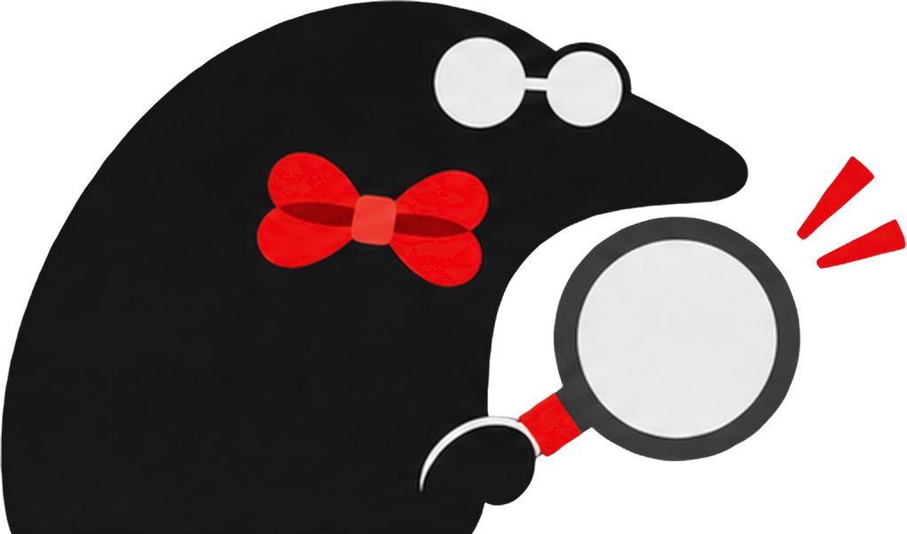

<p align="center">
  <picture>
    <source media="(prefers-color-scheme: dark)" srcset="docs/readme/microphone-dark.png">
    
  </picture>
</p>

<h1 align="center">Molière</h1>

<p align="center"><b>Automated co-presenter.</b><br>LauzHack 2026 · Alt+F4</p>

Molière listens to you during a call and puts the right slide, file, website or app on the screen you share. You talk to your audience as usual; Molière works out when you are asking for something and drives the shared screen for you.

It is one Kotlin Compose Multiplatform app: a desktop app on your Mac and an Android companion on the phone in your hand. Speech recognition and both models run on the Mac, inside the app. There is no model server.

## What the presenter sees

<picture>
  <source media="(prefers-color-scheme: dark)" srcset="docs/readme/stopwatch-dark.png">
  
</picture>

A small bar at the bottom of your screen shows what Molière heard and what it is doing. Commands on what is already on screen act at once: "Next slide please.", "Go to slide 7.", "Scroll down a bit.", "Close that." A request by meaning, such as "So how big is this market really?", is announced first ("Showing slide 5") next to a Stop button that drains for up to 2.5 seconds. Say "no", or press Stop on the bar or the phone, and nothing reaches the shared screen. After something is shown, "no, go back" puts the previous screen back. Chatter does nothing: "I sent the PDF to Marc this morning." is not a request.

The phone shows the same mole and line as the bar, with the same buttons, and buzzes when something needs you.

Outside a call, Molière does not listen and has no phone link. It wakes when a call app takes the microphone, or when you choose **Start a meeting** from the mole in the menu bar.

## How a sentence reaches the screen

<picture>
  <source media="(prefers-color-scheme: dark)" srcset="docs/readme/pickaxe-dark.png">
  
</picture>

1. **Hearing.** Apple's SpeechTranscriber (macOS 26) turns your voice into words on the Mac. `stage/Ear.kt` runs `hear.swift` and tells it which names to expect: your decks, slide titles, sites and apps.
2. **Session.** `session/Session.kt` passes each new version of the utterance to the agent with what the audience sees now. `Contract.kt` is the contract between ear, agent and screen: `Heard` and `OnScreen` in, a `Move` out.
3. **Retrieval.** EmbeddingGemma embeds the utterance and takes eight candidates from the catalog (`decider/Catalog.kt`): the meeting's slides and documents, bookmarks, apps, and what you saw lately (recent files, browser pages, decks elsewhere on the Mac).
4. **Decision.** `decider/Prompt.kt` writes the screen, the last utterances and the numbered candidates into a short prompt. A Gemma 3 270M fine tuned for this task (`decider.litertlm`) answers one line from a small grammar: `show 3`, `next`, `control scroll down`, `undo`, `nothing`.
5. **Action.** `decider/ModelAgent.kt` turns the answer into a move. Picks by meaning wait as long as the model's score leaves doubt; commands act at once. The session carries out one move at a time and tells the bar and the phone.
6. **Shared screen.** The audience sees Chrome in kiosk mode inside a macOS VM run by `agent-desktop`, driven over the DevTools protocol by `stage/Stage.kt`. You share the VM window, titled "Molière screen".

Only the models interpret speech: no word list or pattern reads what you say. `tune/CONTRACT.md` defines the prompt, the grammar and what each answer does; the training code and the app both follow it.

## Run it

<picture>
  <source media="(prefers-color-scheme: dark)" srcset="docs/readme/folder-dark.png">
  
</picture>

You need macOS 26 with Xcode's command line tools (`xcode-select --install`), [mise](https://mise.jdx.dev/) and [uv](https://docs.astral.sh/uv/). For the shared screen you need `agent-desktop` (`npm install -g agent-desktop`) and its VM, set up once as described below. Without the VM, `--host` uses a Chrome window on your Mac.

```sh
mise trust && mise install          # JDK 21, Android SDK; accept the licenses when asked
mise exec -- ./gradlew :composeApp:createDistributable
uv run --no-project --with reportlab python fixtures/make_decks.py library
python3 -I fixtures/make_documents.py library
```

The app is `composeApp/build/compose/binaries/main/app/Moliere.app`. On first start it downloads EmbeddingGemma to `~/Library/Application Support/Moliere/models/`. Put `decider.litertlm` in the same folder; it comes from the fine tune in `tune/` (see `tune/README.md`). Without it, a meeting says "Couldn't load the models." and names the missing file.

```sh
APP=composeApp/build/compose/binaries/main/app/Moliere.app
$APP/Contents/MacOS/Moliere --demo                                          # the bar's scripted story, no models or VM
$APP/Contents/MacOS/Moliere --typed --library "$PWD/library" --no-history   # type lines instead of speaking; add --host without a VM
open $APP                                                                   # the real thing, from the menu bar mole
```

With `--typed`, wait for "Hi. I'm listening.", then type a line and press Return. The log is `~/Library/Logs/Moliere/moliere.log`, and what the audience saw after each change is in `~/Library/Logs/Moliere/screens/`. The flags are listed above `fun main` in `composeApp/src/desktopMain/kotlin/ch/lauzhack/app/Main.kt`.

For the phone, run `mise run android` with the phone connected (or `mise run android:emulator:setup` once, then `mise run android:emulator`). Put the phone and the Mac on the same network, ideally the phone's hotspot. The phone finds the laptop once a meeting runs. During a meeting the phone streams microphone audio to the Mac over the local, unencrypted WebSocket connection, and the Mac transcribes it locally. Leaving the Android app stops the stream.

`DEMO.txt` is the demo runbook: the test lines and what each must do, permissions, the phone, troubleshooting, the measured scores and what Molière still gets wrong.

## One-time VM setup

1. `agent-desktop sandbox install macos`.
2. Get a macOS 26.x restore image. Apple's catalog offers only 27.x, which a 26.4 host cannot run. The 26.4 image is `https://updates.cdn-apple.com/2026WinterFCS/fullrestores/122-00766/062A6121-2ABE-45D7-BCB1-72B666B6D2C2/UniversalMac_26.4_25E246_Restore.ipsw` (19.7 GB, `shasum` 177baf85518c6e9cebf83990e11e59259b5c97dd).
3. `agent-desktop sandbox create base --provider macos --set ipsw=<path>`, then repeat `agent-desktop sandbox status base` until it stops answering `working`. Delete the image afterwards.
4. Optional: lower `memorySize` in `~/.agent-desktop/sandboxes/base/vm/config.json` from 8589934592 to 4294967296.
5. `agent-desktop sandbox start base --window --set title="Molière screen"`.
6. In the guest, finish Setup Assistant with the same short name as your Mac account (`cat ~/.agent-desktop/sandboxes/base/guest_user`) and turn on automatic login.
7. In the guest Terminal, run `sh "/Volumes/My Shared Files/guest-setup.sh"`.
8. In the guest, turn on Remote Login (System Settings > General > Sharing) and allow Accessibility for `sshd-keygen-wrapper`.
9. On the host, `agent-desktop sandbox status base` answers `running`.

At each meeting start, `Vm.setup` in `stage/Vm.kt` finishes the job when needed: it makes the VM's host a part of Molière, with no Dock icon or menu bar of its own, shares Desktop, Documents and Downloads read only at the same paths, matches your screen size, wallpaper and appearance, installs Chrome and restarts the VM. It patches `agent-desktop`'s VM host to share the folders, so it runs again after an `agent-desktop` update. It also starts the VM when it is stopped. To rerun step 7 later, the script is at `/Volumes/My Shared Files/agent-desktop/guest-setup.sh`.

## Test

<picture>
  <source media="(prefers-color-scheme: dark)" srcset="docs/readme/magnifier-dark.png">
  
</picture>

```sh
mise exec -- ./gradlew :composeApp:desktopTest                   # session, catalog, prompt (byte for byte against tune/golden.jsonl), stage, link, UI
rehearsal/run.sh rehearsal/demo.txt .stage/rehearsal/demo 6       # a scenario typed into the packaged app, against the VM
python3 rehearsal/check.py .stage/rehearsal/demo                  # each line scored, with the cause of each miss
AVD=lauzhack-2026 mise exec -- androidApp/check.sh                # the phone app end to end on an emulator
```

Screenshot renders of the bar and the window run with `MOLE_SHOTS=1`; the levers against real Chrome and this Mac's files run with `MOLE_LIBRARY` and `MOLE_RECENTS`. Anything that scores a model runs on Modal, never on the Mac: `eval/modal_decider.py` replays the eval scripts through the Kotlin `ModelAgent`.

## Layout

- `composeApp/src/commonMain/`: code the laptop and the phone share. `Contract.kt`, `session/` (the loop), `decider/` (agent, catalog, prompt), `mole/` (the bar and the phone screen), `link/` (laptop to phone).
- `composeApp/src/desktopMain/`: the Mac app. `Main.kt` (flags, menu bar), `session/Laptop.kt` (a meeting's lifecycle), `stage/` (ear, shared screen, VM, decks, recent files, browser history), `meeting/` (call detection).
- `composeApp/src/litert/`: the in-process LiteRT-LM runtime, desktop only.
- `composeApp/src/androidMain/`, `androidApp/`: the phone app.
- `tune/`: training data, fine tune and scoring of the decider on Modal; `tune/CONTRACT.md` is the contract with the app.
- `eval/`: the eval scripts (one line is something said and what the screen should show after it) and the Modal runners.
- `rehearsal/`: scenarios driven through the packaged app and their scoring; `latency/lever.py` measures voice-to-screen time.
- `fixtures/`: the sample decks and documents.
- `mole/`: the web design page the app's look is checked against.
